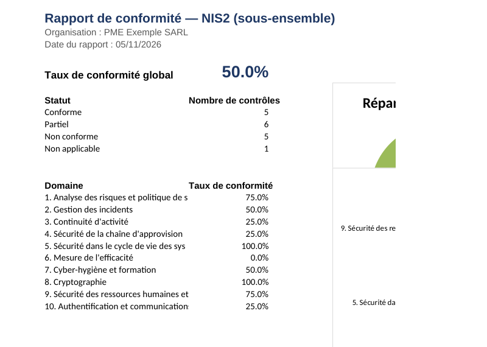

# Compliance-as-Code — Automated ISO 27001 / NIS2 Compliance Audit

[](https://github.com/saharhamdi/compliance-as-code/actions/workflows/ci.yml)

A Python tool that turns a compliance framework (ISO 27001, NIS2...) into an
**actionable audit**: it matches the framework's controls against audit
responses, computes compliance rates, and generates a **professional Excel
report** (graphical summary, control-by-control detail, criticality-based
action plan).

> Companion project to the **NIS2 Practical Guide for SMEs**: where the
> guide explains *what* to do, this tool helps *measure where you stand*
> and prioritize the remaining actions.



## Why this project

SMEs and institutions that need to comply with NIS2 or ISO 27001 often have
neither an in-house CISO nor the budget for a costly audit. Most compliance
checklists exist as a PDF or a static spreadsheet: fine to read, but useless
for **tracking progress over time** or producing a report a board can
actually look at.

This project addresses a concrete need: a **reusable, version-controlled**
framework (YAML), a **reproducible** audit (the same script always produces
the same report for the same answers), and a **shareable** output (an Excel
file with charts, not a raw export).

## Features

- Control frameworks defined in YAML, easy to extend or adapt to another
  regulatory framework (ANCS, PCI DSS, etc.)
- Global and per-domain compliance rate calculation (a `partial` control
  counts as half-compliant)
- Action plan automatically **prioritized by criticality**, with the
  expected evidence and a recommended action for each gap
- 3-tab Excel report: **Summary** (charts), **Control Detail**
  (status-based color coding), **Action Plan**
- Explicit handling of `not_applicable` controls (excluded from the rate
  calculation)
- A framework control with no audit response is never silently skipped: it
  shows up as `non-compliant` with a comment to fill in — no gap can slip
  through unnoticed

## Installation

```bash
git clone https://github.com/<your-account>/compliance-as-code.git
cd compliance-as-code
pip install -r requirements.txt
```

Requires Python 3.9+.

## Usage

```bash
python cli.py \
  --referentiel referentiels/nis2.yaml \
  --reponses exemples/reponses_exemple_nis2.csv \
  --organisation "Example SME Ltd" \
  --nom-referentiel "NIS2 (subset)" \
  --out rapports/rapport_nis2.xlsx
```

```
Rapport généré : rapports/rapport_nis2.xlsx
Taux de conformité global : 50.0 %
Contrôles en écart (plan d'action) : 11
```

Same logic with the provided ISO 27001 framework:

```bash
python cli.py \
  --referentiel referentiels/iso27001_annexe_a.yaml \
  --reponses exemples/reponses_exemple_iso27001.csv \
  --organisation "Example SME Ltd" \
  --out rapports/rapport_iso27001.xlsx
```

> Note: command-line options and console output are in French
> (`--referentiel`, `--reponses`, `Taux de conformité global`, etc.), since
> this is the language the tool was built and documented in for its
> primary (French-speaking) audience. The logic and structure below apply
> regardless of language.

### Options

| Option | Description |
|---|---|
| `--referentiel` | Path to the framework YAML file (required) |
| `--reponses` | Path to the audit responses CSV file (required) |
| `--out` | Path of the Excel report to generate |
| `--organisation` | Organization name shown in the report header |
| `--nom-referentiel` | Framework name shown in the report (default: file name) |

## Framework format (YAML)

```yaml
- id: "NIS2-1.1"
  domaine: "1. Risk analysis and security policy"
  controle: "Information system security policy"
  description: "..."
  preuve_attendue: "Signed and dated security policy document"
  criticite: "Élevée"           # Élevée (High) | Moyenne (Medium) | Faible (Low)
  action_recommandee: "..."
  reference: "Directive (EU) 2022/2555, art. 21(2)(a)"
```

## Audit responses format (CSV)

```csv
control_id,statut,preuve_fournie,commentaire
NIS2-1.1,conforme,oui,Security policy v2 approved by management in March 2026
NIS2-2.2,non_conforme,non,No formal regulatory notification process in place
```

Accepted statuses: `conforme` (compliant), `non_conforme` (non-compliant),
`partiel` (partial), `non_applicable` (not applicable).

## Project structure

```
compliance-as-code/
├── referentiels/               # Control frameworks (YAML)
│   ├── nis2.yaml
│   └── iso27001_annexe_a.yaml
├── compliance_tool/             # Python package
│   ├── models.py                 # Data structures (Control, Finding...)
│   ├── loader.py                 # YAML/CSV loading
│   ├── scoring.py                 # Rate and action-plan computation
│   └── report_excel.py            # Excel report generation
├── exemples/                    # Sample (fictional) audit responses
├── rapports/                    # Generated reports (git-ignored)
├── tests/                       # Unit tests for the scoring engine
└── cli.py                       # Command-line entry point
```

## Extending to another framework

Adding a new regulatory framework (PCI DSS, ANCS...) is just a matter of
creating a new YAML file following the same schema — no code change needed.

## Tests

```bash
python tests/test_scoring.py
```

## Limitations and disclaimer

- The frameworks provided (`referentiels/`) are **educational subsets**,
  freely rephrased from the public text of the NIS2 directive and the
  structure of ISO/IEC 27001:2022 Annex A. They do not replace the
  official standard text (ISO 27001 is copyrighted by ISO) nor an audit
  carried out by a qualified professional.
- The sample files in `exemples/` contain **entirely fictional** data, for
  demonstration purposes only.
- This tool measures a declarative state (what the auditor observed and
  recorded) — it does not replace the actual collection of evidence.

## About

Project built by **Sahar Hamdi**, Cybersecurity Engineer / CISO,
specialized in GRC, compliance auditing (ISO 27001, NIS2), and IAM/PAM.

- LinkedIn: *(link to be added)*
- Other portfolio projects: [Risk Management Lab](#), [Secure IaC Lab](#)

## License

MIT — see [LICENSE](LICENSE).
